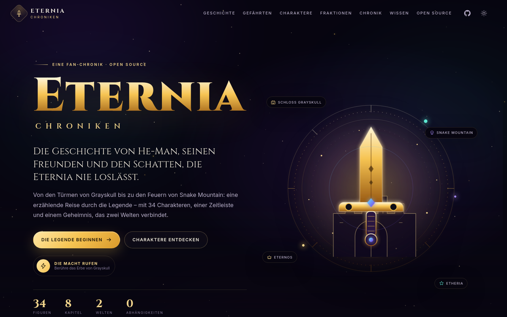

# Eternia Chroniken

> Die Geschichte von He-Man, seinen Freunden und Feinden – eine offene, inoffizielle Fan-Chronik.

[](#lizenz)
[](#warum-vanilla)
[](#technik)
[](#auf-github-pages-veröffentlichen)
[](CONTRIBUTING.md)



**Eternia Chroniken** erzählt die Legende von He-Man als lesbare, interaktive Website: von den ersten Wächtern von Grayskull über Keldors Fall bis zur Großen Rebellion auf Etheria. 34 Figuren, acht Kapitel, zwei Welten – und der Frage, was Macht bedeutet, wenn man sie nicht für sich selbst will.

Das Projekt ist bewusst **dependency-frei**: reines HTML, CSS und JavaScript, selbst gehostete Schriften, kein Tracking, keine Cookies, keine externen Requests zur Laufzeit. Einfach forken, anpassen und hosten.

> **Inoffizielles Fanprojekt.** Masters of the Universe, He-Man, She-Ra und alle zugehörigen Figuren sind Marken von Mattel. Dieses Projekt steht in keiner Verbindung zu Mattel. Es wird kein offizielles Artwork verwendet; alle Texte sind eigenständige Fan-Zusammenfassungen, alle Grafiken sind eigene, abstrakte Illustrationen. Mehr dazu in [NOTICE.md](NOTICE.md).

---

## Inhaltsverzeichnis

- [Funktionen](#funktionen)
- [Schnellstart](#schnellstart)
- [Auf GitHub Pages veröffentlichen](#auf-github-pages-veröffentlichen)
- [Repository-Link anpassen](#repository-link-anpassen)
- [Projektstruktur](#projektstruktur)
- [Eine Figur hinzufügen](#eine-figur-hinzufügen)
- [Mitwirken](#mitwirken)
- [Technik](#technik)
- [Warum Vanilla?](#warum-vanilla)
- [Barrierefreiheit](#barrierefreiheit)
- [Datenschutz](#datenschutz)
- [Kontinuität & Inhalte](#kontinuität--inhalte)
- [Lizenz](#lizenz)
- [Danksagung](#danksagung)

---

## Funktionen

- **34 Charaktere** aus Helden, Verbündeten und Schurken – jeweils mit Geschichte, Motto, Werten, Verbindungen, Hintergrundwissen und eigener Heraldik.
- **Der innere Kreis:** Teela, Man-At-Arms, die Sorceress, Orko und Battle Cat als interaktive Gefährten-Porträts.
- **Suche & Filter:** live nach Namen suchen, nach Fraktion filtern, Zufallsfigur ziehen – inklusive Trefferanzahl und leerem Zustand.
- **Detail-Dialog:** Tastaturbedienung, Fokusfalle, Deep-Links (`#charakter=he-man`), Vor/Zurück-Navigation und „Link kopieren“.
- **Chronik:** acht Kapitel mit alternierender Zeitleiste und markierten Kontinuitäts-Varianten.
- **Fraktionen:** Grayskull, Eternos, Snake Mountain und ein eigener Blick nach Etheria.
- **Helles & dunkles Design:** „Grayskull-Pergament“ und „Eternia-Nacht“, gespeichert in `localStorage`, ohne Tracking.
- **Sternenfeld & Grayskull-Effekt:** Canvas-Sterne, Meteore und ein kleiner Power-Moment. Tippe irgendwo `grayskull` – oder benutze den Button im Hero.
- **Responsive & zugänglich:** mobile Navigation, Fokus-Indikatoren, `aria-live`-Status, Reduced-Motion-Unterstützung, semantische Struktur.
- **Zero Dependencies:** keine Pakete, kein Build-Schritt, keine CDN-Abhängigkeiten, self-hosted Fonts.
- **GitHub-Pages-ready:** mitgelieferter Actions-Workflow.

## Schnellstart

```bash
git clone https://github.com/BarciBarci/eternia-chroniken.git
cd eternia-chroniken

# Empfohlen: lokaler Webserver (damit alle Browser die Fonts korrekt laden)
python3 -m http.server 8000
```

Dann <http://localhost:8000> öffnen.

Alternativ kannst du `index.html` direkt im Browser öffnen. Ein lokaler Server ist trotzdem die verlässlichere Variante, unter anderem für saubere Font- und Pfadauflösung.

### Statische Prüfung

```bash
python3 tools/check_site.py
```

Der Check benötigt nur Python 3 und prüft lokale Dateiverweise, Anchor-Ziele, doppelte IDs, Sprite-Icons sowie Allies/Enemies-Referenzen. Dieselbe Prüfung läuft in der GitHub-Action `Static checks`.

## Auf GitHub Pages veröffentlichen

1. Repository auf GitHub anlegen und den Inhalt dieses Ordners pushen. Der Standardbranch sollte `main` heißen (oder passe die Branch in der Workflow-Datei an).
2. Im Repository unter **Settings → Pages → Build and deployment** als **Source** die Option **GitHub Actions** wählen.
3. `.github/workflows/deploy.yml` übernimmt den Rest: Bei jedem Push auf `main` wird die Seite als statisches Artefakt veröffentlicht.
4. Nach dem ersten erfolgreichen Lauf findest du die URL unter **Settings → Pages** bzw. im Reiter **Actions**.

Die Website nutzt ausschließlich relative Pfade und funktioniert daher sowohl unter `https://BarciBarci.github.io/eternia-chroniken/` als auch unter einer eigenen Domain.

**Social-Preview:** Für optimale Vorschauen auf Social Media solltest du in `index.html` die `og:image`- und `twitter:image`-URLs auf die absolute Adresse deiner veröffentlichten Seite setzen (z. B. `https://BarciBarci.github.io/eternia-chroniken/assets/img/og-image.png`). Das Bild liegt bereits unter `assets/img/og-image.png` (1200 × 630).

## Repository-Link anpassen

Alle GitHub-Links in der Oberfläche werden aus einer einzigen Stelle gesteuert:

```js
// assets/js/data.js
site: {
  name: 'Eternia Chroniken',
  tagline: 'Die Geschichte von He-Man, seinen Freunden und Feinden',
  repo: 'https://github.com/BarciBarci/eternia-chroniken',
  // …
}
```

Ersetze den Platzhalter durch dein Repository. Die Links im Header, im Mobile-Menü, im Open-Source-Bereich und im Footer werden beim Laden automatisch aktualisiert. Für Umgebungen ohne JavaScript kannst du zusätzlich die `href`-Platzhalter in `index.html` ersetzen.

## Projektstruktur

```text
.
├── index.html                  # Semantische Seite + Icon-Sprite + Meta-Tags
├── assets/
│   ├── css/styles.css          # Design-System, Layout, Animationen, Themes
│   ├── js/
│   │   ├── data.js             # Alle Inhalte: Figuren, Story, Chronik, Fakten
│   │   └── app.js              # Rendering, Filter, Dialog, Routing, Effekte
│   ├── fonts/                  # Cinzel + Inter (SIL Open Font License)
│   └── img/                    # Favicon, Icons, OG-Bild, Vorschau
├── tools/
│   ├── check_site.py           # Statische Prüfung ohne Abhängigkeiten
│   ├── make_icons.py           # Erzeugt die Raster-Icons (nur Asset-Pflege)
│   └── og-card.html            # Vorlage für das Social-Preview-Bild
├── CONTRIBUTING.md             # Wie du Figuren und Inhalte ergänzt
├── NOTICE.md                   # Marken- und Inhaltshinweise
├── LICENSE                     # MIT-Lizenz für den Code
└── .github/workflows/          # GitHub Pages + statische Checks
```

## Eine Figur hinzufügen

Alle Figuren stehen in `assets/js/data.js`. Ein Eintrag sieht so aus:

```js
{
  id: 'beispiel-held',
  name: 'Beispiel-Held',
  alias: 'Der Namenlose',
  title: 'Wächter von Irgendwo',
  faction: 'helden',              // helden | verbuendete | schurken
  group: 'Grayskull',
  home: 'Eternia',
  species: 'Eternianer',
  era: 'Klassische Ära',
  icon: 'shield',                 // Symbol-ID aus dem Sprite in index.html
  colors: ['#f6c453', '#7c3aed'],
  short: 'Ein Satz für die Karte.',
  story: 'Zwei bis vier Sätze Geschichte …',
  motto: 'Ein eigenes Motto.',
  allies: ['he-man'],
  enemies: ['skeletor'],
  stats: { power: 7, wisdom: 8, courage: 9, magic: 2 },
  facts: ['Ein Detail.', 'Noch ein Detail.'],
}
```

Wichtig:

- `id` muss eindeutig sein und darf nur in `allies`/`enemies` referenziert werden, wenn die Figur existiert.
- `faction` steuert Filter, Zähler und Farbgebung.
- `icon` muss als `<symbol id="i-DEIN-ICON">` im Sprite in `index.html` existieren. Alternativ kannst du ein vorhandenes Symbol wiederverwenden.
- Zähler und Filter passen sich automatisch an; du musst keine Zahlen im HTML ändern.
- Neue Figuren erscheinen in der Reihenfolge des Arrays. Die ersten Einträge sind bewusst die Kernfiguren.

Mehr Details, Schreibrichtlinien und eine PR-Checkliste stehen in [CONTRIBUTING.md](CONTRIBUTING.md).

## Mitwirken

Beiträge sind willkommen – egal ob neue Figuren, bessere Texte, Accessibility-Verbesserungen, neue Icons oder ein weiteres Kapitel der Chronik.

1. Forke das Repository.
2. Erstelle einen Branch: `git checkout -b feature/meine-idee`.
3. Ändere die Inhalte oder den Code.
4. Prüfe die Seite lokal bei Desktop- und Mobilbreite.
5. Öffne einen Pull Request mit einer kurzen Beschreibung.

Bitte verwende keine kopierten Texte oder offizielles Artwork. Schreibe eigene Zusammenfassungen, markiere Kontinuitäts-Varianten und bleib respektvoll. Details: [CONTRIBUTING.md](CONTRIBUTING.md).

## Technik

- **HTML5**, **CSS3** und **Vanilla JavaScript** – keine Frameworks, keine Bundler.
- **Self-hosted Fonts:** [Cinzel](https://fonts.google.com/specimen/Cinzel) für Display-Typografie, [Inter](https://fonts.google.com/specimen/Inter) für Fließtext; beide unter der SIL Open Font License (Lizenzdateien in `assets/fonts/`).
- **Canvas-Sternenfeld** mit DPR-Skalierung, Pause bei verstecktem Tab und Reduced-Motion-Fallback.
- **CSS-Variablen** für das komplette Design-System, inklusive zwei Themes.
- **SVG-Icon-Sprite** statt Icon-Font oder externer Bibliothek.
- **IntersectionObserver** für Scroll-Reveals und **requestAnimationFrame** für Scroll-Effekte.
- **Keine Netzwerkrequests** nach dem Laden der Seite; alles liegt im Repository.
- Moderne Browser (Chrome, Edge, Firefox, Safari) werden unterstützt. Sehr alte Browser ohne `color-mix()` oder `IntersectionObserver` erhalten eine reduzierte, aber lesbare Darstellung.

## Warum Vanilla?

Weil eine Fan-Chronik Jahrzehnte überdauern sollte:

- **Keine Supply-Chain:** Kein `npm install`, keine veralteten Pakete, keine Build-Tools, die in fünf Jahren nicht mehr laufen.
- **Lesbar und forkbar:** Wer HTML und CSS kann, kann diese Seite anpassen.
- **Schnell:** Ein einziges Dokument, zwei Skripte, eine Stylesheet-Datei, lokale Fonts.
- **Offline-fähig:** Nach dem Laden bzw. mit einem lokalen Server funktioniert alles ohne externe Dienste.
- **GitHub-Pages-freundlich:** Kein Build-Artefakt, das gepflegt werden muss.

## Barrierefreiheit

Die Seite wurde mit Blick auf Tastatur- und Screenreader-Nutzung gebaut:

- Skip-Link, semantische Landmarks und sinnvolle Überschriftenhierarchie.
- Sichtbare Fokus-Indikatoren und vollständige Tastaturbedienung der Filter, Tabs und Dialoge.
- Fokusfalle und Fokus-Rückgabe im Charakter-Dialog, `Escape` zum Schließen, Pfeiltasten zum Blättern.
- `aria-live`-Statusmeldungen für Trefferzahlen und Dialogwechsel.
- Respektiert `prefers-reduced-motion`; Animationen werden reduziert oder abgeschaltet.
- Ausreichende Kontraste in beiden Themes.

Wenn du eine Barriere findest, öffne gern ein Issue.

## Datenschutz

- **Kein Tracking, keine Analytics, keine Werbung.**
- **Keine Cookies.** Der einzige gespeicherte Zustand ist das gewählte Theme in `localStorage`.
- **Keine externen Requests zur Laufzeit.** Schriften und Icons liegen lokal im Repository.
- **Keine Server-Komponente.** Die Seite ist vollständig statisch.

## Kontinuität & Inhalte

Masters of the Universe wurde über Jahrzehnte mehrfach neu erzählt. Minicomics, die Filmation-Serien, der Kinofilm von 1987, die 2002er-Serie und neuere Neuinterpretationen unterscheiden sich in vielen Details.

Diese Chronik verfolgt keinen Anspruch auf eine einzige kanonische Wahrheit. Sie verbindet klassische Motive zu einer lesbaren Erzählung und markiert an wichtigen Stellen, wenn eine Aussage vor allem aus einer späteren Variante stammt – zum Beispiel Keldors Herkunft als Skeletor oder Teelas Rolle als Sorceress in neueren Erzählungen.

Wenn du eine Figur oder ein Kapitel ergänzt: Schreibe eigenständig, kennzeichne Varianten und vermeide lange Zitate aus Serien, Comics oder Wikis.

## Lizenz

- **Code:** [MIT](LICENSE) – frei nutzbar, veränderbar und weitergebbar.
- **Schriften:** SIL Open Font License; siehe `assets/fonts/OFL-Cinzel.txt` und `assets/fonts/OFL-Inter.txt`.
- **Figuren, Namen und Marken:** Masters of the Universe, He-Man, She-Ra und alle zugehörigen Figuren sind Marken und geistiges Eigentum von Mattel. Siehe [NOTICE.md](NOTICE.md).
- **Fan-Texte und eigene Grafiken:** Eigenständige Inhalte dieses Projekts. Bitte beachte bei einer Weiterverwendung die Markenrechte von Mattel.

## Danksagung

Inspiriert von den vielen Erzählungen rund um Eternia – von den klassischen Minicomics und der Filmation-Ära über die 2002er-Serie bis zu den neueren Neuinterpretationen. Danke an alle, die diese Welt seit Jahrzehnten weitererzählen.

Danke außerdem an Natanael Gama (Cinzel) und Rasmus Andersson (Inter) für die großartigen Schriften unter der SIL Open Font License.

---

**Viel Spaß beim Erzählen. Und denk daran: Nicht das Schwert macht den Helden. Es ist die Entscheidung, es zu erheben.**
